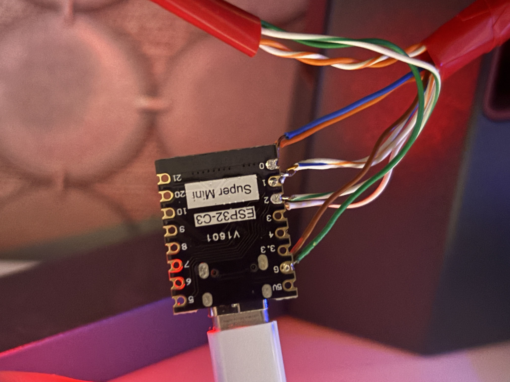
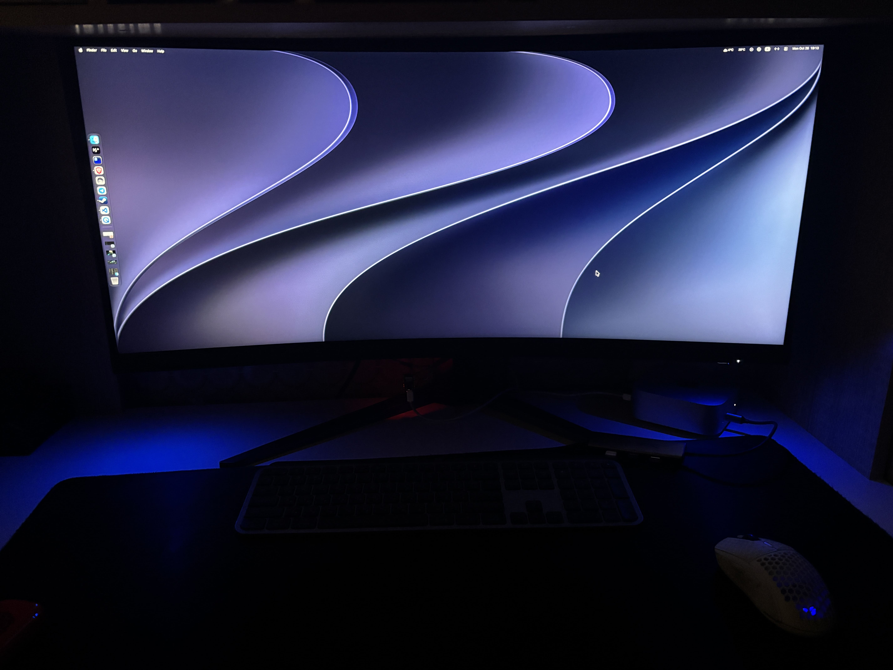

# Board

Контроллер получает команды по USB и меняет цвет светодиодов. Для минамальной сборки требуется сам микроконтроллер и RGB светодиод.





## Настройка

Настройка микроконтроллера в [main.cpp](./board/src/main.cpp)

```cpp
const uint8_t PIN_R = 0; // ПИН для красного цвета
const uint8_t PIN_G = 2; // ПИН для зеленого цвета
const uint8_t PIN_B = 1; // ПИН для синего цвета
const bool COMMON_ANODE = false; // true - светодиод с общим анодом (+)
const uint32_t BAUD = 115200; // Скорость работы serial port. Она должна быть одинаковой с обеих сторон
const uint16_t FRAME_MS = 10; // Задержка цикла loop
```

Для идентификации порта можно запустить скрипт [линукс](../get-path-linux) [macos](../get-path-macos)

## Examples

Минимальный пример - [basic.rs](./led-client/examples/basic.rs)

### Простой пример Axum + LED

Простой пример axum сервера, который перенаправляет полученные команды в микроконтроллер

1. Настройте [http клиент](./led-client/examples/http.rs)

    ```rs
    const BAUD: u32 = 115200; // Скорость работы serial port. Она должна быть одинаковой с обеих сторон
    const PATH: &'static str = "/dev/ttyACM0"; // порт для комуникации
    const DELAY: Duration = Duration::from_millis(50); // Задержка между открытием порта и началом работы. Duration::ZERO работает через раз на ESP32
    const ADDR: &'static str = "127.0.0.1:5678"; // IP:PORT
    ```

2. Подключете микроконтроллер по USB к ПК
3. Запустите http клиент с помощью команды `cargo run --example http`
4. Отправьте команду с помощью [test.sh](./led-client/examples/test.sh) или запустите [demo.sh](./led-client/examples/demo.sh)

### Dota lighting

[**ВИДЕО НА YOUTUBE**](https://youtu.be/T69do24J16Q)

Динамическая подсветка монитора для игры Dota 2.  Реагирует на события:

```
===================================================================
EVENT               Цвет            Тип эффекта     Время (секунды)
===================================================================
Kill                255, 0, 149     FX              0.2 0   0.4
Died                255, 0, 0       FX              10  5   5
Respawned           35, 255, 22     FX              1.5 2   5
LevelUp             255, 255, 30    FX              0.1 1   2
DayTime(true)       122, 253, 194   BASE            2
DayTime(false)      100, 15, 255    BASE            2
Smoked(any)         NONE
MagicImmune(any)    NONE
Paused(any)         NONE
===================================================================
```


1. Настройте клиент в [dota_lighting.rs](./led-client/examples/dota_lighting.rs)

    ```rs
    const BAUD: u32 = 115200;
    const PORT: &'static str = "/dev/cu.usbmodem101";
    const TIMEOUT: Duration = Duration::from_millis(50);
    ```

2. Подключете микроконтроллер по USB к ПК
3. Запустите с помощью cargo run --example `dota_lighting`
4. Запустите игру


## Команды и аргументы

- **BASE** - Установка базового цвета
    - `R`, `G`, `B` - Аргументы для установки цвета (0-255)
    - `ms` - Длительность перехода (мс)

- **FX** - Выполнение эффекта
    - `R`, `G`, `B` - Аргументы для установки цвета (0-255)
    - `ATTACK` - Переход от базового цвета к цвету эффекта (мс)
    - `HOLD` - Длительность эффекта (мс)
    - `RELEASE` - Переход от цвета эффекта к базовому (мс)

- **PING** - Возвращает PONG
