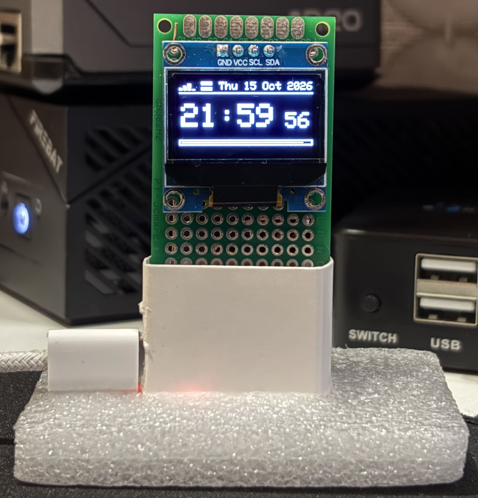

# supermini_oled

`ESP32 C3 Super Mini` + `SSD1306` для отображения времени, даты, Wi-Fi, соединения с сервером, температуры и влажности.

## Подключение 

```
SSD1306     ESP32 C3 Super Mini
GND         GND
VCC         5V
SCL         GPIO 9
SDA         GPIO 8

DHT11       ESP32 C3 Super Mini
GND         GND
DATA        GPIO 0
VCC         5V
```

## Картинки


